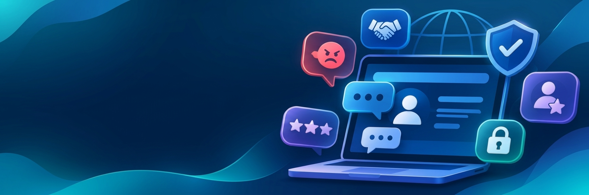

# 🛡️ SafeNet — Цифрова грамотність

## 📖 Про проєкт

SafeNet — освітній вебсайт, створений для підвищення
рівня цифрової грамотності серед учнів та молоді.

Мета проєкту — навчити користувачів культурно,
відповідально та безпечно спілкуватися в інтернеті.

## 📚 Основні розділи

- 🤝 Мережевий етикет
- ⚡ Конфлікти онлайн
- 🔒 Безпечне спілкування
- ⭐ Цифрова репутація

## ✨ Функціональні можливості

- Світла та темна теми оформлення.
- Українська та англійська мови.
- Автоматична зміна зображень залежно від теми.
- Збереження налаштувань користувача через LocalStorage.
- Адаптивний дизайн для різних пристроїв.
- Плавна прокрутка сторінки.
- Зручна навігація.
- Інтерактивні кнопки та анімації.

## 🖼️ Зовнішній вигляд

## 💻 Використані технології

| Технологія | Призначення |
|------------|-------------|
| HTML5 | Структура вебсайту |
| CSS3 | Дизайн та адаптивність |
| JavaScript | Інтерактивність |
| LocalStorage | Збереження налаштувань |
| Git | Контроль версій |
| GitHub | Зберігання проєкту |

## 📁 Структура проєкту

    safenet-main/
    ├── main.html
    ├── conflict.html
    ├── coch.css
    ├── site.js
    ├── README.md
    └── photos/
        ├── logo.png
        ├── light-logo.png
        ├── banner.jpg
        ├── light-banner.png
        ├── et2.png
        ├── et-dark.png
        ├── conf2.png
        ├── conf-dark.png
        ├── sc2.png
        ├── sc-dark.png
        ├── rep1.png
        └── rep-dark.png

## 🚀 Запуск проєкту

1. Завантажте репозиторій.
2. Відкрийте папку проєкту.
3. Запустіть файл main.html у браузері.

Також можна використовувати розширення Live Server
у Visual Studio Code.

## 🎯 Мета проєкту

- Формування культури онлайн-спілкування.
- Запобігання кібербулінгу.
- Захист персональних даних.
- Формування позитивної цифрової репутації.
- Підвищення цифрової грамотності.

## 📌 Плани розвитку

- Додавання інтерактивних тестів.
- Створення окремих сторінок для кожної теми.
- Додавання практичних завдань.
- Покращення дизайну та функціональності.

## 👥 Команда проєкту

### Красночубенко Кирилл Костянтинович
**QA Engineer / Frontend Developer**
- Розробка вебсайту за допомогою HTML, CSS та JavaScript.
- Реалізація інтерактивних функцій та адаптивності.
- Тестування вебсайту, виявлення та виправлення помилок.
- Робота з Git та GitHub.

### Маріненко Микита Сергійович
**UI/UX Designer**
- Розробка візуальної концепції вебсайту.
- Створення логотипа, банерів та ілюстрацій.
- Проєктування світлої та темної тем оформлення.
- Забезпечення зручності та привабливості інтерфейсу.

## 📄 2026 — SafeNet

Спілкуйся культурно. Дій відповідально.
Будь у безпеці онлайн.